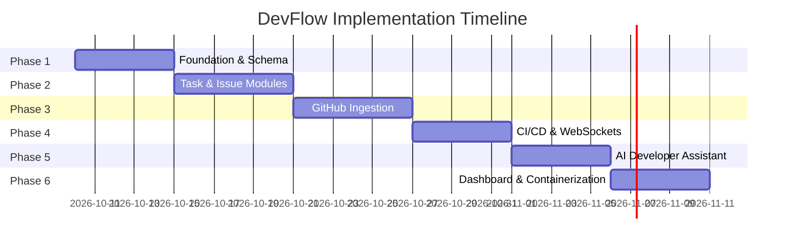

# DevFlow — Comprehensive Project Specification & Module Roadmap

> **DevFlow**: A Unified Developer Collaboration & Engineering Workflow Platform

---

## 1. Project Overview & Problem Statement

### 1.1 The Core Problem
Modern software development teams rely on a fragmented ecosystem of specialized tools:
* **Task Management**: Jira, Trello, Linear
* **Source Control & Code Reviews**: GitHub, GitLab
* **CI/CD & Automation**: GitHub Actions, CircleCI
* **Communication & Chat**: WhatsApp, Discord, Slack

This fragmentation causes severe **context switching**. A developer or project manager must constantly bounce between tabs to answer basic questions:
* *Is task X truly finished or just marked "Done" on Trello?*
* *Why did the latest CI build fail after PR #42 was merged?*
* *What code changes were introduced in the latest release?*

### 1.2 Our Solution
**DevFlow** is a developer-centric collaboration platform that acts as a **central intelligence & visibility layer** sitting on top of existing tools. DevFlow does **not** attempt to replace GitHub or Jira; instead, it synthesizes events, metrics, and automation from these platforms into a single, real-time developer workspace.

### 1.3 Target Value Proposition
* **Zero Context Switching**: View tasks, bugs, PRs, commits, and build statuses in one dashboard.
* **Contextual AI Assistance**: Get instant summaries of PRs and automated root-cause explanations for failed builds.
* **Real-time Synchronization**: Powered by webhooks and WebSockets to give instant status updates across the team.

---

## 2. System Architecture & Tech Stack

```
[ Developer Push / Event ]
           │
           ▼
    [ GitHub / GitHub Actions ]
           │
           ▼ (Webhook HTTP POST)
  ┌────────────────────────────────────────────────────────┐
  │                 DevFlow Backend (Node.js/Express)      │
  │  ┌───────────────────────┐   ┌──────────────────────┐  │
  │  │   BullMQ Job Queue    │   │ Socket.IO WebSockets │  │
  │  └───────────┬───────────┘   └──────────┬───────────┘  │
  └──────────────┼──────────────────────────┼──────────────┘
                 ▼                          ▼
       ┌──────────────────┐       ┌────────────────────┐
       │ PostgreSQL +     │       │ Real-Time Frontend │
       │ Prisma ORM       │       │ React + TypeScript │
       └──────────────────┘       └────────────────────┘
                 ▲
                 │ (Prompt & Context payload)
       ┌──────────────────┐
       │ LLM API          │
       │ (AI Assistant)   │
       └──────────────────┘
```

### Stack Breakdown
* **Frontend**: React, TypeScript, Vanilla CSS (Design Tokens, Glassmorphism, Responsive UI)
* **Backend**: Node.js, Express.js (REST APIs, Webhook Handlers)
* **Database & ORM**: PostgreSQL with Prisma ORM
* **Real-Time Communication**: Socket.IO / WebSockets
* **Background Jobs & Queues**: Redis with BullMQ
* **External Integrations**: GitHub REST & GraphQL APIs, GitHub Webhooks, GitHub Actions CI/CD
* **AI Engine**: LLM API (OpenAI / Gemini API via SDK)
* **Infrastructure**: Docker & Docker Compose containerization

---

## 3. The 6 Core Modules Breakdown

---

### Module 1: Project & Task Management
**Focus**: Project organizational structure, task allocation, and workflow state tracking.

* **Key Features**:
  * Project creation, workspace management, and team member role management.
  * Interactive **Kanban Board** supporting custom stages (`To Do` → `In Progress` → `Review` → `Done`).
  * Task assignment, priority flags (`Low`, `Medium`, `High`, `Urgent`), deadline tracking, and tagging.
  * Linking tasks directly to GitHub branches, Pull Requests, and Issues.

---

### Module 2: Issue & Bug Tracking
**Focus**: Defect lifecycle management and developer assignment.

* **Key Features**:
  * Dedicated Bug & Issue reporting interface with reproduction steps and severity levels.
  * Workflow transitions (`Open` → `Triaged` → `In Fix` → `Resolved` → `Closed`).
  * Cross-referencing bugs with specific task items and GitHub commits.
  * Automated notifications when an issue status changes or when mentioned.

---

### Module 3: GitHub Integration
**Focus**: Deep bidirectional synchronization with GitHub repository activity.

* **Key Features**:
  * GitHub Repository connecting (via Personal Access Tokens / OAuth App).
  * Webhook listener endpoint for instant ingestion of repository events:
    * `push` (Commits stream)
    * `pull_request` (PR creation, edits, reviews, merges)
    * `issues` (GitHub issues sync)
  * Live feed of recent commits, PR author details, diff summaries, and branch updates.

---

### Module 4: CI/CD Monitoring
**Focus**: Real-time pipeline status visibility and build diagnostics.

* **Key Features**:
  * Integration with **GitHub Actions** workflow webhooks (`workflow_run`, `workflow_job`).
  * Real-time build status indicators (✅ `Passed`, ❌ `Failed`, ⏳ `In Progress`, ⚠️ `Cancelled`).
  * Extraction and structured storage of build logs, job durations, and test suite outcomes.
  * One-click trigger to pass failed build logs directly into the AI Assistant for diagnosis.

---

### Module 5: AI Developer Assistant
**Focus**: Domain-specific AI assistant embedded directly into software workflows.

* **Key Features**:
  * **PR Summarizer**: Analyzes PR code changes/diffs and generates human-readable changelogs.
  * **Build Error Explainer**: Ingests failed CI/CD log snippets and explains the exact stack trace cause in plain English with code fix suggestions.
  * **Issue Cause Analyzer**: Evaluates issue descriptions and suggests relevant code components to check.
  * **Contextual Chatbot**: Interactive developer assistant aware of current project tasks, active PRs, and repository state.

---

### Module 6: Real-Time Dashboard & Analytics
**Focus**: High-level telemetry, unified metrics, and live activity streams.

* **Key Features**:
  * Multi-widget summary dashboard (Task counts, open issues, PR status, build health index).
  * Developer activity stream showing live team commits, task movements, and CI triggers.
  * Interactive charts for velocity tracking, build success rate, and issue resolution time.
  * WebSocket-driven live UI updates (zero manually required browser refreshes).

---

## 4. Implementation Phases Roadmap



### Phase 1: Planning, Data Modeling & Foundation Setup
* **Goals**: Establish project skeleton, database schema, and initial backend/frontend setup.
* **Deliverables**:
  1. Monorepo or clean directory structure setup for `frontend` and `backend`.
  2. Prisma schema definition covering entities: `User`, `Project`, `Task`, `Issue`, `Repository`, `PullRequest`, `Commit`, `BuildRun`, `AILog`.
  3. PostgreSQL database initialization via Prisma migrations.
  4. Node.js/Express server boilerplate with authentication (JWT / Session) and error handling middleware.
  5. React + TypeScript frontend scaffold with theme design tokens (colors, typography, glassmorphism CSS).

---

### Phase 2: Core Task & Issue Management Systems (Modules 1 & 2)
* **Goals**: Implement full CRUD and interactive Kanban/Issue boards.
* **Deliverables**:
  1. REST APIs for Project, Task, and Issue management.
  2. Frontend **Kanban Board** with drag-and-drop / column movement (`To Do` → `Done`).
  3. Issue & Bug tracking grid with filterable priorities, assignees, and status tags.
  4. Task/Issue detail modal view with activity logs and assignment controls.

---

### Phase 3: GitHub Integration & Webhook Queue Infrastructure (Module 3)
* **Goals**: Establish secure webhooks and background job processing for GitHub data.
* **Deliverables**:
  1. Webhook endpoint `/api/webhooks/github` verifying secret signatures (`X-Hub-Signature-256`).
  2. BullMQ + Redis job queue setup to process incoming payload events asynchronously without blocking HTTP response threads.
  3. Event handlers for `push` events (parsing commits) and `pull_request` events (storing PR metadata).
  4. Frontend GitHub activity feed displaying live PR status and recent commit logs.

---

### Phase 4: CI/CD Monitoring & Real-Time Sync (Module 4 & WebSockets)
* **Goals**: Ingest GitHub Actions CI/CD runs and push live updates to the UI.
* **Deliverables**:
  1. Webhook listener for `workflow_run` and `workflow_job` GitHub events.
  2. Socket.IO WebSocket server integrated with backend events.
  3. Client-side WebSocket listener updating Kanban boards, commit streams, and build status banners instantly.
  4. CI/CD Pipeline status monitor component with job duration, branch info, and log reader modal.

---

### Phase 5: AI Developer Assistant Integration (Module 5)
* **Goals**: Connect LLM service and implement workflow-specific AI features.
* **Deliverables**:
  1. Backend AI service module wrapping LLM API calls with structured prompt templates.
  2. **PR Summarization** tool fetching PR diffs and outputting structured release summaries.
  3. **Build Error Diagnosis** tool parsing failed CI/CD log snippets to highlight root causes and propose fixes.
  4. Frontend AI Assistant Panel (Drawer/Sidebar) enabling developers to query project state and receive instant insights.

---

### Phase 6: Unified Dashboard, Analytics & Deployment (Module 6)
* **Goals**: Aggregate metrics, polish UI/UX aesthetics, and package with Docker.
* **Deliverables**:
  1. Central Executive Dashboard combining metrics from all 6 modules.
  2. Visual charts & analytics widgets (open issues ratio, build pass rate, weekly commit trends).
  3. Final UI/UX polish (dark glassmorphism theme, smooth animations, responsive layout).
  4. `Dockerfile` and `docker-compose.yml` for unified local setup (Frontend, Backend, Postgres, Redis).
